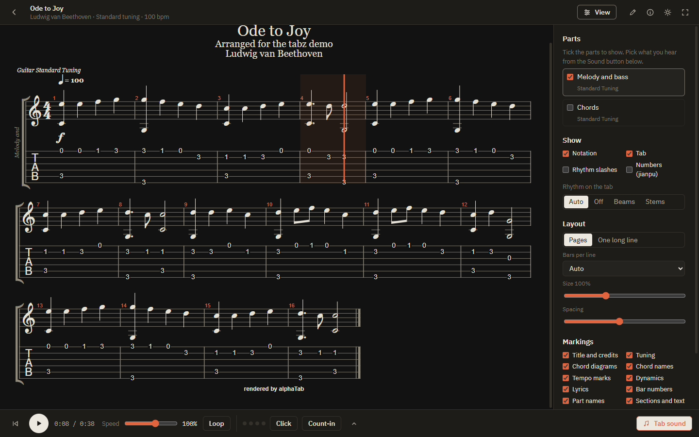
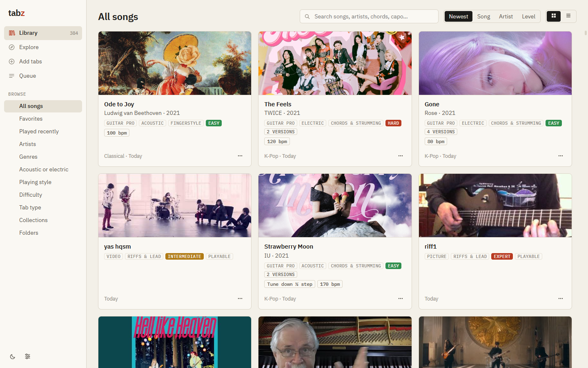
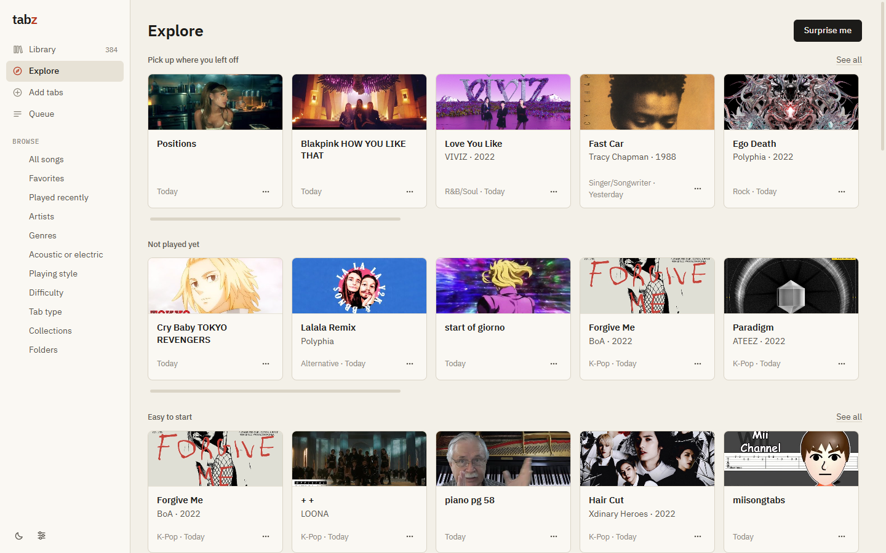
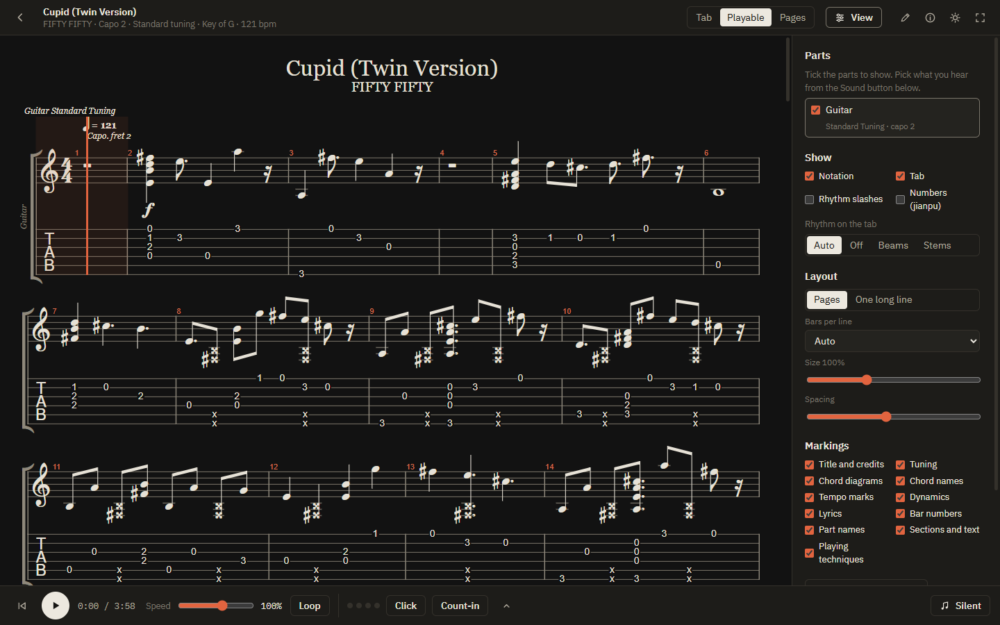
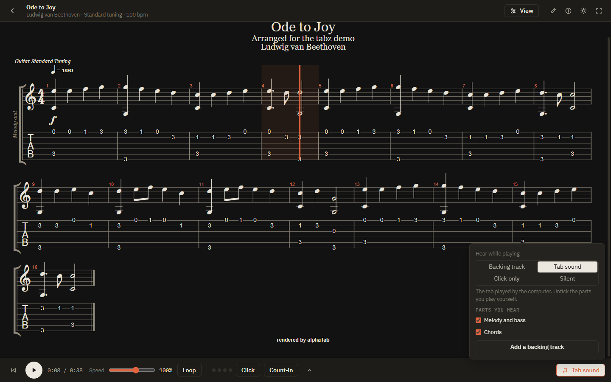
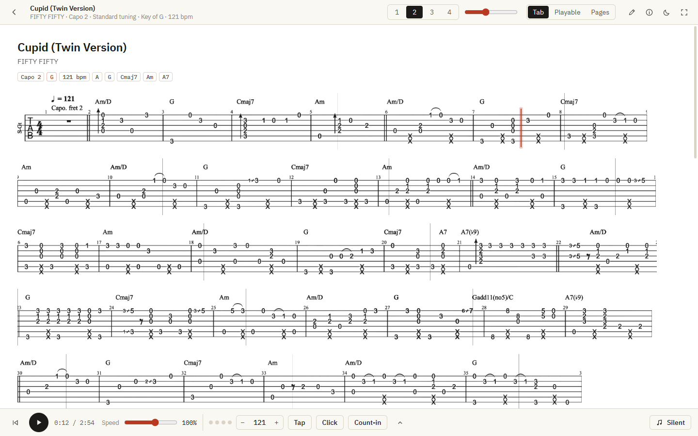
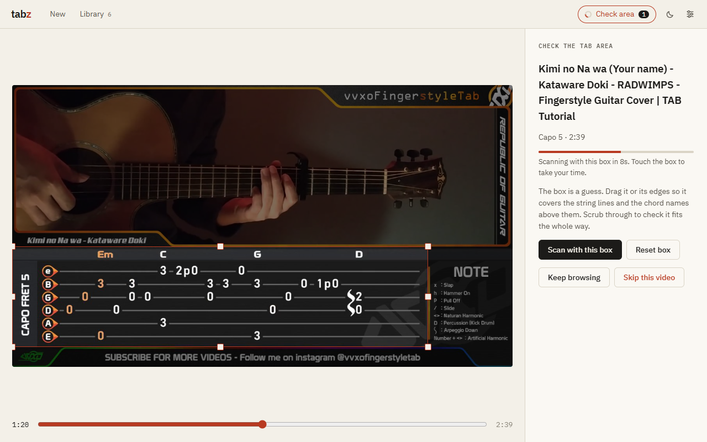
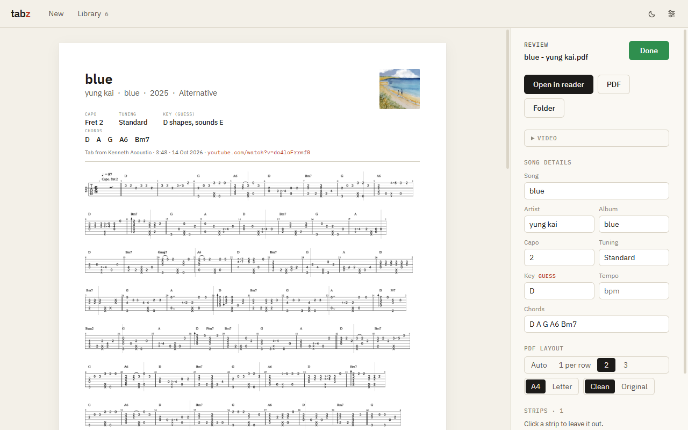
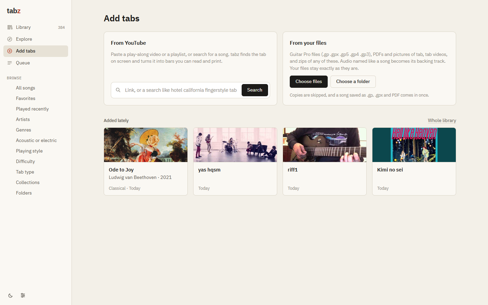

<p align="center"></p>

<h1 align="center">tabz</h1>

<p align="center">
  Guitar tab you can read, hear and play along with.<br>
  <a href="https://shreywy.github.io/tabz/"><b>Website and live demo</b></a> ·
  <a href="https://github.com/shreywy/tabz/releases/latest"><b>Download for Windows</b></a>
</p>

tabz is a guitar tab library and practice reader for Windows. It turns YouTube play-along
videos into tab, opens your Guitar Pro files, reads PDFs and pictures of tab into scores you
can hear, and plays everything along with a backing track while a line moves through the
music.



## What it does

### Your whole collection in one library

Point tabz at a folder and it brings in Guitar Pro files (.gp, .gpx, .gp5, .gp4, .gp3), PDFs,
pictures of tab, tab videos and zips of them. Copies are skipped, and a song saved as .gp,
.gpx and PDF comes in once. Browse by artist, genre, acoustic or electric, playing style,
difficulty, tab type, collection or the folder a file came from. Versions of the same song
(the score, its PDF, another arrangement) live in one card. Star favorites, and use Explore
when you don't know what to play.





### Guitar Pro scores, viewed your way

Scores are drawn and played by [alphaTab](https://alphatab.net). The View panel picks which
parts to show (one by default), turns standard notation, tab, rhythm slashes and numbered
notation on or off, sets rhythm on the tab, page or one-long-line layout, bars per line, size
and spacing, and chooses which markings appear: chord diagrams, tempo, dynamics, lyrics,
playing techniques and more. Any score can be saved as a Guitar Pro file.

### Tab from pictures, made playable

tabz reads the fret numbers in tab from videos, PDFs and pictures into notes, so you can hear
the tab and follow it like a Guitar Pro score (the Playable view), or save it as a .gp file.
The picture of the tab is kept as it was, and Tab, Playable and Pages switch between them. On
PDFs exported from Guitar Pro, about 9 in 10 notes come out right. Rhythm is a guess from the
spacing, so it's the weakest part.



### Play along

Play moves a line through the music. Choose what you hear: a backing track, the tab's own sound
with the parts you play yourself turned off, just the click, or nothing at all. The click and a
count-in can go on top of any of them. Speed goes from 25% to 150%, and a backing track slows
down without changing pitch. Click any bar to start from there; Home goes back to the start.

Attach your own audio as a backing track, or search YouTube for one and tabz downloads just the
sound (with a Gemini key, Gemini picks the best result). If the line runs early or late, nudge
the sync, or press Set by ear and tap when you hear the bar start. The sync is saved with the
song.



### YouTube play-along videos into tab

Paste a link or a playlist, or search for a song. tabz downloads the video, finds the tab on
screen, follows it as it swaps or scrolls, and saves every bar as one clean PDF and as a song
that reflows to any window size.





- **Works on any tab style it finds.** It doesn't know about channels. It looks for groups of
  4 to 7 evenly spaced lines, so 6-string, bass, ukulele and 7-string tab all work, with or
  without standard notation above.
- **Swap and scroll.** Videos that show a few bars and then replace them become one strip per
  page. Videos that slide the tab sideways get stitched into one continuous staff, broken at
  barlines.
- **One clean look.** Highlight boxes, playheads, dark skins and notes that change colour when
  played all come out as black ink on white.
- **Song details.** Song, artist, album, year, genre and cover art come from the iTunes
  Search API. Capo, tuning and tempo are read from the screen (Windows' built-in OCR) and the
  description. Chords are read from the names above the staff, and the key is guessed from
  them.
- **PDF.** Title, details and a clickable link to the video at the top. 1, 2 or 3 screens of
  tab per row, or Auto. A4 or Letter. Review lets you fix details, change the layout or leave
  out strips.



### And also

- **Style and difficulty**, read from the notes: mostly chords is strumming, bass under a
  melody or arpeggios is fingerstyle, other single notes are riffs and lead. Difficulty (1 to 5)
  goes up with notes per second, techniques like bends and taps, reach up the neck, wide
  stretches and muted hits.
- **Search box takes links.** Paste a video link into the library search to get it.
- **Metronome.** Beep, hi-hat, woodblock, kick + hat or rim click. 2/4 to 7/8, subdivisions,
  accent on or off, tap tempo.
- **Queue.** Up to 3 downloads and 2 scans at once, imports alongside. It opens beside the
  library, so nothing is covered.
- **Light and dark.**



## Download

1. Go to [Releases](https://github.com/shreywy/tabz/releases/latest) and download `tabz.exe`.
2. Put it in its own folder, for example `Documents\tabz\`. tabz saves next to itself:
   PDFs go in `Completed\`, the library and settings in `.tabz\`.
3. Run it. Windows SmartScreen may say it doesn't recognise the app, because the exe isn't
   code-signed. Click **More info**, then **Run anyway**.

Windows 10 or 11. The window uses Microsoft Edge WebView2, which Windows 11 has built in and
most Windows 10 machines already have.

## Using it

1. **Add something.** From Add tabs, paste a video or playlist link, search for a song, or
   choose files or a folder. Everything runs in the background.
2. **Check the tab area** (videos only). tabz shows a frame with a box around the tab. Drag it
   if it's off; left alone, it goes ahead with the guess after 15 seconds.
3. **Play.** Open a song, pick what you hear from the Sound button, set the speed and press
   play.

Importing only reads your files: tabz keeps its own copies, and importing the same folder
again only adds what's new. Audio named like a song ("Song Backing Track.wav") becomes that
song's backing track.

## Optional: Gemini

Settings has a field for a Gemini API key from [Google AI Studio](https://aistudio.google.com).
With a key, Gemini also reads each video's title and description for the song, artist, capo,
tuning and tempo, and picks backing tracks from YouTube results. Everything works without
one. The key is stored only in tabz's own settings file next to the exe.

## How it works

The video and PDF pipeline is plain OpenCV and NumPy, no machine learning.

1. **Find the staff.** Thin marks are separated from their background with morphological
   closing and opening, so the same code handles dark ink on paper and light ink on dark
   panels. Runs of 4 to 7 evenly spaced lines become staves. In a video, the staff that
   appears in the most of 24 sampled frames wins. PDF pages are rendered with Windows' own
   PDF engine and searched the same way.
2. **Clean.** Anything wider than a stroke is background: highlight boxes, panels, gradients.
   What's left is ink.
3. **Track** (videos). Four frames a second, each compared with the last after removing the
   staff lines. Small shifts are scrolling and get stitched; big jumps only count once the
   picture settles; a highlight jumping back on an unchanged page is a repeat.
4. **Lay out.** Each strip is fitted to exactly the expected number of lines, scaled to one
   string spacing, and cut at barlines.
5. **Read notes.** String lines are lifted out (keeping the strokes of digits that sit on
   them), and each mark on a string is matched against digit shapes drawn in common fonts.
   Numbers stacked at one place are a chord; the space before the next note sets its length.
   The result is alphaTex, which alphaTab plays.

Tests: `tests/test_videos.py` runs the video pipeline on 14 videos from different channels and
checks strip counts. `tests/test_import.py` checks importing (duplicates, PDFs to bars,
backing tracks, reading notes, source files untouched). `tests/test_queue.py` checks the queue.

## Build from source

Python 3.11 or newer on Windows.

```bash
pip install -r requirements.txt
python run.py
```

To build the exe:

```bash
python -m PyInstaller tabz.spec --noconfirm
```

The result is `dist/tabz.exe` (about 85 MB, mostly OpenCV).

| File | What's in it |
| --- | --- |
| `tabz/vision.py` | Finding, cleaning and tracking the tab |
| `tabz/layout.py` | Fitting the staff, rows and the PDF |
| `tabz/transcribe.py` | Reading fret numbers in tab images into notes |
| `tabz/imports.py` | Importing files: matching duplicates, PDF pages, Guitar Pro headers |
| `tabz/info.py` | Song details: OCR, iTunes, chords, key, Gemini |
| `tabz/jobs.py` | The background queue |
| `tabz/library.py` | Saved songs and the local file server |
| `tabz/app.py` | The bridge between Python and the window |
| `tabz/ui/` | The interface; `play.js` is the reader, `gp.js` the score viewer |
| `docs/` | The website and these screenshots |

## Limits

- Notes read from pictures of tab are a best effort: expect some wrong frets, and rhythm that
  only roughly follows the music. Hand-drawn tab, or tab where the string lines run through
  the numbers, reads worse. The picture itself is always there to check against.
- No editing of Guitar Pro files; they're for reading and playing along.
- TuxGuitar (.tg), MIDI, .rar and .7z files aren't read. Extract archives to a folder first.
- Private playlists can't be read, since tabz isn't signed in to YouTube.
- Age-restricted and members-only videos can't be downloaded.

## Please support the people who make these

The tabs belong to the people who arranged and filmed them. tabz is for your own practice,
the same way you'd pause the video and copy it down. Don't share the PDFs as your own, and if a
creator sells their tabs or has a Patreon, buy from them. Downloading from YouTube may go
against YouTube's terms in your country, so use it on videos you're allowed to save.

The tab in the screenshots is from Kenneth Acoustic and vvxoFingerstyleTab. The score is an
arrangement of Beethoven's Ode to Joy written for this project.

## Credits

Built on [yt-dlp](https://github.com/yt-dlp/yt-dlp), [OpenCV](https://opencv.org),
[NumPy](https://numpy.org), [ReportLab](https://www.reportlab.com), [alphaTab](https://alphatab.net),
[pywebview](https://pywebview.flowrl.com), [winocr](https://github.com/GitHub30/winocr) and
[IBM Plex](https://github.com/IBM/plex). Song details from the
[iTunes Search API](https://performance-partners.apple.com/search-api).

## License

MIT. See [LICENSE](LICENSE). The IBM Plex fonts are under the SIL Open Font License.
alphaTab is under the Mozilla Public License 2.0, its Bravura font under the SIL Open Font
License and its Sonivox soundfont under the Apache License 2.0; see `tabz/ui/vendor/alphatab/`.
