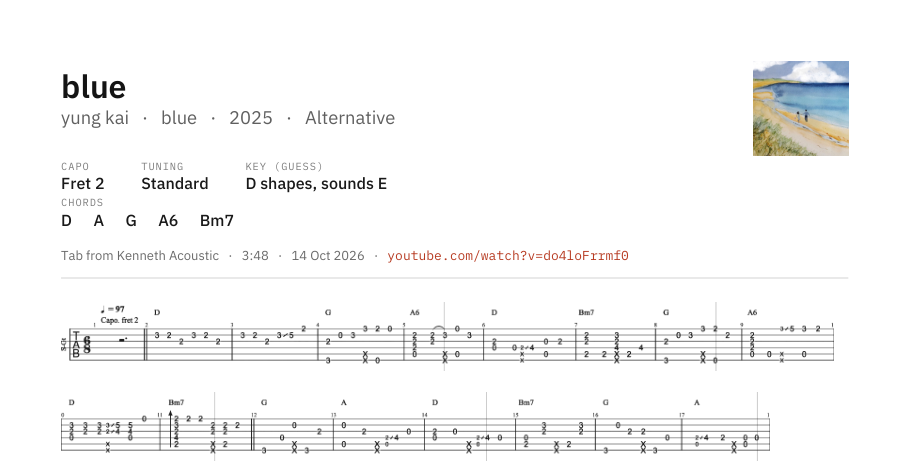

# tabz

Turns YouTube play-along guitar videos into tab you can print or read on screen.

Paste a link, a playlist, or search for a song. tabz downloads the video, finds the tab on
screen, follows it as it swaps or scrolls, and saves every bar as one clean PDF and as a
song in its library. The reader reflows the tab to any screen size and has a metronome.


## Download

1. Go to [Releases](https://github.com/shreywy/tabz/releases/latest) and download `tabz.exe`.
2. Put it in its own folder, for example `Documents\tabz\`. tabz saves next to itself:
   PDFs go in `Completed\`, the library and settings in `.tabz\`.
3. Run it. Windows SmartScreen may say it doesn't recognise the app, because the exe isn't
   code-signed. Click **More info**, then **Run anyway**.

Windows 10 or 11. The window uses Microsoft Edge WebView2, which Windows 11 has built in and
most Windows 10 machines already have. The first launch takes a few seconds while the exe
unpacks.

## Using it

1. **Add something.** Paste a video link, paste a playlist link, or type a search like
   `dust in the wind fingerstyle tab` and click results to queue them. Everything runs in the
   background, so you can keep browsing, reading, or adding more.
2. **Check the tab area.** tabz guesses where the tab is and shows a frame from the middle of
   the video with a box around it. Drag the box if it's off, then scan. If you leave it alone,
   it goes ahead with the guess after 15 seconds. Playlist videos skip this step.
3. **Read or print.** Finished songs land in the library. Open one in the reader, or open its
   PDF. Review lets you fix the song details, change the PDF layout, or leave out strips you
   don't want.


## What it does

- **Works on any tab style it finds.** It doesn't know about channels. It looks for groups of
  4 to 7 evenly spaced lines, so 6-string, bass, ukulele and 7-string tab all work, with or
  without standard notation above.
- **Swap and scroll.** Videos that show a few bars and then replace them become one strip per
  page. Videos that slide the tab sideways get stitched into one continuous staff, broken at
  barlines.
- **One clean look.** Highlight boxes, playheads, dark skins and notes that change colour when
  played all come out as black ink on white. Staff lines are redrawn solid, and every strip is
  scaled to the same string spacing so rows line up.
- **Song details.** Song, artist, album, year and cover art come from the iTunes Search API.
  Capo, tuning and tempo are read from the screen (Windows' built-in OCR) and the description.
  Chords are read from the names above the staff, and the key is guessed from them, including
  the key you hear with a capo ("D shapes, sounds E").
- **PDF.** Title, details and a clickable link to the video at the top. 1, 2 or 3 screens of
  tab per row, or Auto, which picks the densest layout that keeps the strings at least 1.3 mm
  apart. A4 or Letter. Original colours if you'd rather have raw screenshots.
- **Reader.** Reflows to the window: 1 to 4 screens per line or any size in between. Scroll or
  turn pages (arrow keys and page-turner pedals work). Follow moves through the song at the
  video's pace, scaled by your tempo. Light and dark.
- **Metronome.** Beep, hi-hat, woodblock, kick + hat or rim click. 2/4 to 7/8, subdivisions,
  accent on or off, tap tempo. Drag the tempo number sideways to change it.
- **Queue.** Up to 3 downloads and 2 scans at once. Playlists are filed as a collection, and
  private or deleted videos are listed as skipped with the reason.
- **Library.** Search by song, artist, chord or capo. Collections, cards or list view.




## Optional: Gemini

Settings has a field for a Gemini API key from [Google AI Studio](https://aistudio.google.com).
With a key, Gemini also reads each video's title and description for the song, artist, capo,
tuning and tempo. Everything works without one. The key is stored only in tabz's own settings
file next to the exe.

## How it works

The pipeline is plain OpenCV and NumPy, no machine learning.

1. **Find the staff.** Thin marks are separated from their background with morphological
   closing and opening, so the same code handles dark ink on paper and light ink on dark
   panels. Rows covered by long horizontal runs become line candidates, and runs of 4 to 7
   evenly spaced lines become staves. The staff that appears in the most of 24 sampled frames
   wins. A notation staff sitting just above it joins it as one system.
2. **Grow the box.** From the staff outward until the background changes, which stops at panel
   edges, title bars and subtitles.
3. **Clean.** Anything wider than a stroke is background: highlight boxes, panels, gradients.
   What's left is ink. Colour doesn't matter, only contrast.
4. **Track.** Four frames a second. Each is compared with the last one after removing the staff
   lines (they look the same at every offset). A template match with several candidates,
   verified across the whole overlap, gives the sideways shift. Small shifts are scrolling and
   get stitched. Big jumps only count once the picture settles, so crossfades and slides
   don't add bars twice. Anything else is a new page. Frames are averaged into each strip, so
   playheads and moving highlights drop out.
5. **Lay out.** Each strip is fitted to exactly the expected number of lines, scaled to one
   string spacing, and broken at barlines (or at gaps between notes when there are none) to
   fill rows.

`tests/test_videos.py` runs the whole thing on 12 videos from different channels and styles
and checks the number of strips and whether they stitched. Run it after any change to
`vision.py`.

## Build from source

Python 3.11 or newer on Windows.

```bash
pip install -r requirements.txt
python run.py
```

To build the exe:

```bash
python -m PyInstaller tabz.spec --noconfirm
```

The result is `dist/tabz.exe` (about 80 MB, mostly OpenCV).

| File | What's in it |
| --- | --- |
| `tabz/vision.py` | Finding, cleaning and tracking the tab |
| `tabz/layout.py` | Fitting the staff, rows and the PDF |
| `tabz/info.py` | Song details: OCR, iTunes, chords, key, Gemini |
| `tabz/jobs.py` | The background queue |
| `tabz/library.py` | Saved songs and the local image server |
| `tabz/app.py` | The bridge between Python and the window |
| `tabz/ui/` | The interface (HTML, CSS, JS) |

## Limits

- Tab only. It keeps the tab as cleaned images and doesn't turn it into text or notes.
- Private playlists can't be read, since tabz isn't signed in to YouTube. Set the playlist to
  Unlisted, or add the videos one at a time.
- Age-restricted and members-only videos can't be downloaded.
- Busy video backgrounds right under a tab panel can leave a few faint marks.
- Chord and key detection is best-effort. Review lets you correct anything.

## Please support the people who make these

The tabs belong to the people who arranged and filmed them. tabz is for your own practice,
the same way you'd pause the video and copy it down. Don't share the PDFs as your own, and if a
creator sells their tabs or has a Patreon, buy from them. Downloading from YouTube may go
against YouTube's terms in your country, so use it on videos you're allowed to save.

The tabs in the screenshots are from Kenneth Acoustic, vvxoFingerstyleTab, Simple Guitar Tabs,
Jinsung Lee and Abz Collado.

## Credits

Built on [yt-dlp](https://github.com/yt-dlp/yt-dlp), [OpenCV](https://opencv.org),
[NumPy](https://numpy.org), [ReportLab](https://www.reportlab.com),
[pywebview](https://pywebview.flowrl.com), [winocr](https://github.com/GitHub30/winocr) and
[IBM Plex](https://github.com/IBM/plex). Song details from the
[iTunes Search API](https://performance-partners.apple.com/search-api).

## License

MIT. See [LICENSE](LICENSE). The IBM Plex fonts are under the SIL Open Font License.
